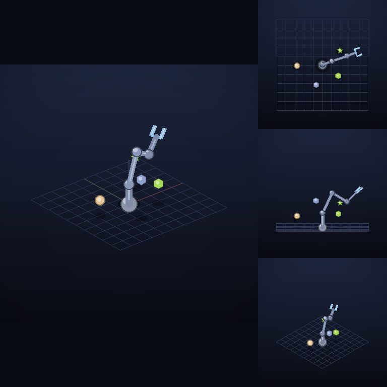

# AMP Toy Robotics Benchmark

**A light, seed-generated benchmark for small vision-language-action (VLA) robot policies.**



A 6-joint arm, four coloured shapes, three fixed cameras, and instructions in
plain English: *"pick up the lime star then move to the midpoint between the
tan circle and the lavender hexagon"*. A policy sees what the cameras see,
reads one clause at a time, and drives the arm itself.

- **Light.** numpy and Pillow, nothing else. No physics engine, no GPU, no
  simulator to install. It scores the reference teacher on the standard
  300 held-out scenes in under a minute on one CPU core.
- **Unlimited, reproducible training data.** Every scene comes from an
  integer seed, and a scripted teacher labels every moment. There is no
  dataset to download: the same seed gives the same images and labels, bit
  for bit, on any machine. Training and test scenes are separate seed ranges.
- **Grounding tests.** Five quick checks of whether a policy really uses
  its cameras and its instruction. Recent studies found that large VLAs
  often do not ([LIBERO-PRO](https://arxiv.org/abs/2510.03827),
  [LIBERO-Plus](https://arxiv.org/abs/2510.13626)).

It comes from [Adaptive Machine Patterns](https://adaptive-machine-patterns.com),
where it is the testbed for [AMP Tadpole](https://huggingface.co/Adaptive-Machine-Patterns/amp-tadpole)
and the AMP Embodied AI Workbench.

## Install

Clone the repository and install:

    git clone https://github.com/Adaptive-Machine-Patterns/amp-toy-robotics
    cd amp-toy-robotics
    pip install .                    # numpy + Pillow only
    pip install ".[packages]"        # + torch, to load model packages

Use `pip install -e .` instead if you want to edit the code and have
changes take effect without reinstalling. Requires Python 3.10+.

## Usage

    amp-bench show --seed 9000007 --out scene.png      # Make a PNG image of the robot
    amp-bench eval --policy teacher                    # Runs 300 scenarios for teaching
    amp-bench eval --policy my_module:make_policy      # your policy
    amp-bench eval --policy path/to/model-package      # a model package

Reported results use the standard 300 held-out scenes (about 900 clauses;
100 scenes leave too few of some clause types for a stable score). The
reference teacher:

| clauses | pick | move | midpoint | open | close | home | all | path vs teacher |
|---|---|---|---|---|---|---|---|---|
| 898 | 98% | 100% | 100% | 100% | 100% | 100% | **99.4%** | 1.00 |

And [AMP Tadpole](https://huggingface.co/Adaptive-Machine-Patterns/amp-tadpole) v0.2.0, a
6.5M-parameter VLA trained on the benchmark's data:

| clauses | pick | move | midpoint | open | close | home | all | path vs teacher |
|---|---|---|---|---|---|---|---|---|
| 898 | 93% | 94% | 75% | 100% | 100% | 100% | **93.7%** | 1.03 |

Both are unchanged by 0.2.0's joint speed limit, which never slows the teacher
and slowed 0.13% of AMP Tadpole's steps. AMP Tadpole takes 1.13 times the
teacher's steps on the clauses both complete, and its path is 1.96 times a
straight line (the teacher's: 1.90).

## Write a policy

Any object with a `predict` method will do, in any framework:

```python
import numpy as np

class MyPolicy:
    def predict(self, images, state, clause):
        # images: uint8 (3, 3, 512, 512): top, side, iso cameras
        # state:  (7,)  6 joint angles (rad) + gripper (0 open .. 1 closed)
        # clause: "Pick up the lime star", "Return to the home pose", ...
        return np.tile(state, (8, 1))      # (8, 7): the next 8 steps

def make_policy():
    return MyPolicy()
```

    amp-bench eval --policy my_module:make_policy --json results.json

A policy is never given object positions. [RULES.md](RULES.md) has the
rules; [docs/TASK.md](docs/TASK.md) has the task in full.

## Train on it

```python
from amp_toy_robotics import data

batches = data.stream(seed0=0, batch_size=64)   # endless, parallel, reproducible
batch = next(batches)
# batch["images"]  uint8 (64, 3, 3, 512, 512)
# batch["state"]   (64, 7)
# batch["text"]    64 clauses
# batch["action"]  (64, 8, 7): the teacher's next 8 steps, the label
```

Every sample comes from a teacher-driven episode. Some samples are taken
off the teacher's path, so a learner sees how to recover, and some pair
the view with a different instruction, so it must read the words. Seeds from
9,000,000 up are held out.

## Grounding tests

Printed by `amp-bench eval` after the success table, on 100 further
held-out scenes (the standard). Each test changes one thing and watches
the motion the policy asks for:

| test | what changes | a policy that uses its inputs scores |
|---|---|---|
| named object | nothing: does it head for the named object? | close to 1 (cosine with the teacher's motion) |
| other objects | the same, toward the objects *not* named | low |
| image swap | two objects swap places: only the pixels change | close to 1 (0 = ignores the cameras) |
| instruction swap | another object is named: only the words change | close to 1 (0 = ignores the words) |
| blank instruction | the clause is empty | well above 0 (0 = the words make no difference) |

AMP Tadpole v0.2.0 scores 0.98 / 0.31 / 1.00 / 1.00 / 0.95 on these.

## Model packages

A model package is a folder that the benchmark and the AMP Embodied AI
Workbench both load:

    model.py              build() -> torch.nn.Module
                          predict(module, images, state, clause) -> (8, 7)
    weights.safetensors   the module's weights
    model.yaml            name, author, license (and an optional token map)

`model.py` is ordinary Python and runs with your permissions: only load
packages from people you trust.

## Versions

| version | what changed |
|---|---|
| 0.2.0 | **Joint speed limit:** no joint moves more than 0.12 rad per step; a faster request is scaled down as a whole (docs/TASK.md). The teacher never reaches it, so its examples are unchanged. `evaluate` also reports steps and path against the teacher and a straight line, and the share of steps the limit slowed. |
| 0.1.0 | First release. |

## Licence and credits

Apache-2.0: see [LICENSE](LICENSE) and [NOTICE](NOTICE) (the object colours
are ColorBrewer's Set2). [PROVENANCE.md](PROVENANCE.md) says where the code
comes from. © 2026 Adaptive Machine Patterns Ltd.

Provided "as is", without warranty of any kind and with no liability
accepted (Apache-2.0, sections 7 and 8).

## Cite

```bibtex
@software{amp_toy_robotics_2026,
  author    = {Whyte, Andy and {Adaptive Machine Patterns Ltd}},
  title     = {{AMP Toy Robotics Benchmark}},
  year      = {2026},
  version   = {0.2.0},
  url       = {https://github.com/Adaptive-Machine-Patterns/amp-toy-robotics}
}
```
